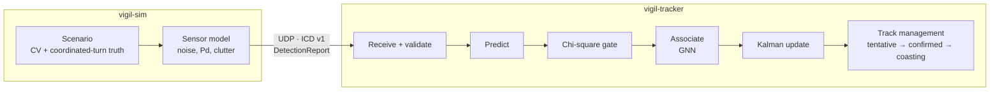

# Vigil: Real-Time Multi-Target Tracker

A multi-target tracking pipeline in modern C++ (C++23) for Linux. A sensor simulator flies
targets and streams noisy detections over UDP. The tracker associates them to tracks, runs a
Kalman filter on each one, and manages each track's lifecycle in real time.

Everything here is built from open-literature algorithms and synthetic data.



## Features

- **Sensor simulator**: constant-velocity and coordinated-turn targets, Gaussian position
  noise, probability of detection below 1, Poisson clutter, shuffled returns, and a
  seed-reproducible scenario.
- **Binary wire protocol** with a written [Interface Control Document](docs/ICD.md).
  The receiver rejects every malformed datagram case and counts lost and out-of-order reports.
- **Kalman filter**: constant-velocity model with discrete white-noise acceleration and a
  Joseph-form update. It uses Cholesky solves instead of explicit inverses.
- **Data association**: chi-square gating (99%, 2 DoF), then global-nearest-neighbour
  assignment on the normalised distance `d² + ln|S|`.
- **Track lifecycle**: M-of-N confirmation, coasting through missed detections, and deletion.
- **Engineering**: CMake presets, GoogleTest (32 tests), Google Benchmark, AddressSanitizer,
  UBSan, ThreadSanitizer, clang-tidy and GitHub Actions CI.

## Quick start

Requires Linux (or WSL2), GCC 13+ or Clang 17+, CMake 3.25+ and Ninja.

```bash
sudo apt install -y build-essential cmake ninja-build libeigen3-dev libgtest-dev libbenchmark-dev

cmake --preset release
cmake --build --preset release
ctest --preset release
```

Run the tracker and the simulator in two terminals:

```bash
./build/release/tracker/vigil-tracker
./build/release/sim/vigil-sim --targets 5 --rate 1
```

```
seq 29     t=    3.00s  dets=9    confirmed=5   coasting=0   tentative=7    11.6 us
  id     status          x (m)      y (m)  spd m/s  hdg deg
  1      CONFIRMED        9569      -8602     97.0    208.4
  2      CONFIRMED       -4762      -6670    129.7    106.2
  3      CONFIRMED       -1901      -1179    224.6    122.7
  4      CONFIRMED       10664      -2926    166.7     62.1
  6      CONFIRMED        7002       6125    114.8    118.4
```

Run `vigil-sim --help` for the scenario options: target count, rate, probability of detection,
clutter density, noise and seed.

## Performance

Measured with `./build/release/bench/vigil_bench` on a Ryzen 9 3900X under WSL2, single-threaded:

| Benchmark | Time per scan |
|---|---:|
| Kalman predict + update (one track) | 0.2 µs |
| Full tracker cycle, 4 targets | 2 µs |
| Full tracker cycle, 64 targets | 0.32 ms |
| Full tracker cycle, 256 targets | 7.3 ms |
| Full tracker cycle, 1024 targets | 141 ms |

Up to about 256 targets the tracker easily meets a 1 Hz scan budget. Gating currently checks
every track against every detection, which is O(N·M), so cost grows quadratically. That is the
first optimisation on the roadmap.

## Testing

| Preset | Purpose |
|---|---|
| `debug` | Day-to-day development |
| `release` | Optimised build for benchmarks and demos |
| `ci` | Release build with `-Werror` |
| `asan` | AddressSanitizer + UndefinedBehaviorSanitizer |
| `tsan` | ThreadSanitizer |

The suite covers the wire format (including every malformed-datagram case), loopback UDP,
target motion, filter convergence and covariance health, and the track lifecycle. An
end-to-end test runs the tracker against 8 simulated targets through clutter and missed
detections, and checks that every target ends with exactly one firm track.

## Roadmap

- [x] **M1**: simulator, ICD, Kalman filter, gating and GNN association, track lifecycle, tests and CI
- [ ] **M2**: optimal assignment (Hungarian / auction), spatial-grid gating to break O(N²),
      multithreaded receive → process pipeline with a lock-free queue, and a latency
      histogram for each stage
- [ ] **M3**: React radar-scope display over WebSocket, plus OSPA accuracy scoring against truth
- [ ] **M4**: authenticated datagrams (HMAC + replay window), a hardened systemd service, and a
      Raspberry Pi acting as a remote sensor node

## Layout

```
common/   wire format (encode/decode) and RAII UDP socket
sim/      scenario + sensor model library, vigil-sim executable
tracker/  Kalman filter, track manager, vigil-tracker executable
tests/    GoogleTest suite
bench/    Google Benchmark suite
docs/     Interface Control Document
```
