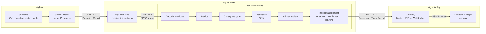

<p align="center">
  <picture>
    <source media="(prefers-color-scheme: dark)" srcset="docs/brand/vigil-logo-white.svg">
    
  </picture>
</p>

# Vigil: Real-Time Multi-Target Tracker

A multi-target tracking pipeline in modern C++ (C++23) for Linux. A sensor simulator flies
targets and streams noisy detections over UDP. The tracker associates them to tracks, runs a
Kalman filter on each one, and manages each track's lifecycle in real time. A React radar
scope shows the live picture in the browser.

Everything here is built from open-literature algorithms and synthetic data.

<!-- Demo: record the scope (e.g. with ScreenToGif) and save it as docs/scope.gif -->



## Features

- **Sensor simulator**: constant-velocity and coordinated-turn targets, Gaussian position
  noise, probability of detection below 1, Poisson clutter, shuffled returns, and a
  seed-reproducible scenario.
- **Binary wire protocol** with a written [Interface Control Document](docs/ICD.md).
  The receiver rejects every malformed datagram case and counts lost and out-of-order reports.
- **Two-thread pipeline**: a receive thread drains the socket and timestamps each datagram,
  and hands it to the tracking thread through a lock-free single-producer / single-consumer
  ring buffer (acquire/release only, no locks or compare-and-swap). If the tracker falls
  behind, the receive thread drops and counts reports instead of blocking. A latency
  histogram for each stage reports p50 to p99.9 when the tracker stops.
- **Kalman filter**: constant-velocity model with discrete white-noise acceleration and a
  Joseph-form update. It uses Cholesky solves instead of explicit inverses.
- **Data association**: chi-square gating (99%, 2 DoF) through a spatial grid, then
  global-nearest-neighbour assignment on the normalised distance `d² + ln|S|`. A scan with
  1,024 targets takes under half a millisecond.
- **Track lifecycle**: M-of-N confirmation, coasting through missed detections, and deletion.
- **Radar-scope display**: a north-up PPI scope drawn on canvas.
  - Detections glow like phosphor as the sweep passes.
  - Tracks show air-traffic-style data blocks, history dots, fading 60-second velocity leaders
    and 2σ uncertainty halos, and are dead-reckoned between scans so motion stays smooth.
  - Glass panels float over the scope. They hold track-status tiles, a tracker-latency
    sparkline with p95, a selected-track card with a heading dial, a track list, and a
    lifecycle event log (confirmed, coasting, reacquired, dropped).
  - Each confirmed track gets a unique callsign (Red Five, USCSS Nostromo, Batwing, …) that
    stays with it until it's dropped. Callsigns exist only in the display; the tracker and
    the ICD still use track numbers.
  - **Show all** (or F) glides out to frame every track. Selecting an off-screen track glides
    the view to it. R recentres on the sensor, and Esc clears the selection.
  - The layout adapts to phones, and it respects reduced-motion settings.
- **Engineering**: CMake presets, GoogleTest (56 tests), Vitest, Google Benchmark,
  AddressSanitizer, UBSan, ThreadSanitizer, clang-tidy and GitHub Actions CI.

## Quick start

Requires Linux (or WSL2), GCC 13+ or Clang 17+, CMake 3.25+, Ninja and Node.js 20+.

```bash
sudo apt install -y build-essential cmake ninja-build libeigen3-dev libgtest-dev libbenchmark-dev nodejs npm
./demo.sh
```

`demo.sh` builds anything that's missing, starts the display, tracker and simulator, and opens
the scope at <http://localhost:5173>. Ctrl-C stops all of them. Any options go to the
simulator, for example `./demo.sh --targets 20 --clutter 6`. Add `--no-open` to skip opening a
browser. Logs go to `build/demo/`.

### Running the pieces by hand

```bash
cmake --preset release
cmake --build --preset release
ctest --preset release
```

Run the tracker and the simulator in two terminals:

```bash
./build/release/tracker/vigil-tracker
./build/release/sim/vigil-sim --targets 5 --rate 1
```

```
seq 29     t=    3.00s  dets=9    confirmed=5   coasting=0   tentative=7    11.6 us
  id     status          x (m)      y (m)  spd m/s  hdg deg
  1      CONFIRMED        9569      -8602     97.0    208.4
  2      CONFIRMED       -4762      -6670    129.7    106.2
  3      CONFIRMED       -1901      -1179    224.6    122.7
  4      CONFIRMED       10664      -2926    166.7     62.1
  6      CONFIRMED        7002       6125    114.8    118.4
```

Run `vigil-sim --help` for the scenario options: target count, rate, probability of detection,
clutter density, noise and seed.

### Radar scope

Requires Node.js 20+. In a third terminal:

```bash
cd display
npm install
npm run dev
```

Open <http://localhost:5173>. The gateway listens for the tracker's display feed on UDP 50001
and serves WebSocket frames on port 8081; Vite proxies `/ws` to it. For a single-process
build, run `npm run build && npm start` and open <http://localhost:8081>.

The scope uses scroll to zoom, drag to pan, click to select a track and double-click to reset
the view. The layer chips toggle detections, trails, leaders, uncertainty, tentative tracks and
the sweep.

## Performance

Full tracker cycle (predict, gate, associate, update, manage) with N targets plus clutter,
measured with `./build/release/bench/vigil_bench` on a Ryzen 9 3900X under WSL2,
single-threaded, median of 3 runs:

| Targets | Original | Per-track gate data | + Spatial grid | Speed-up |
|---:|---:|---:|---:|---:|
| 64 | 316 µs | 26 µs | **22 µs** | 14× |
| 256 | 7.5 ms | 209 µs | **106 µs** | 71× |
| 1,024 | 141 ms | 2.5 ms | **0.47 ms** | 300× |
| 4,096 | — | — | **2.1 ms** | |

Gating got faster in two steps:

1. **Per-track gate data.** The original code rebuilt the innovation covariance, its Cholesky
   factor and its log-determinant for every (track, detection) pair. Computing them once per
   track per scan cut the per-pair cost from about 140 ns to about 2 ns. Gating was still
   O(N·M), just with a much smaller constant.
2. **Spatial grid.** Each scan's detections are bucketed into a uniform grid, with cells sized
   to the median gate. Each track probes only the cells its gate's bounding box touches.
   That box (half-widths √(γ·Sₓₓ) and √(γ·Sᵧᵧ)) provably contains the whole chi-square
   ellipse, so no candidate can be missed. Very wide gates, such as a brand-new track's,
   fall back to checking every detection. Cost now grows roughly linearly: 4× the targets
   takes about 4.4× the time.

The grid is an optimisation only. Tests run the tracker with and without it over a long
scenario and check the track pictures are bit-for-bit identical. Set
`TrackerConfig::spatial_index = false` to compare.

### End-to-end latency

`vigil-tracker` times every report through each stage and prints a table when it stops.
Here it ran 1,000 reports from 50 targets plus clutter at 50 Hz, on the same machine:

| Stage (µs) | p50 | p99 | p50 with `--spin` | p99 with `--spin` |
|---|---:|---:|---:|---:|
| Queue wait (socket → tracker thread) | 34.8 | 65.5 | **0.7** | **3.8** |
| Decode | 1.7 | 3.7 | 1.3 | 4.0 |
| Track | 34.8 | 55.3 | 31.7 | 55.3 |
| Publish to display | 30.7 | 59.4 | 27.6 | 69.6 |
| **Socket to display** | **102** | **172** | **61** | **119** |

By default the tracker thread sleeps in the kernel when the queue is empty, so each report
pays for a thread wake-up of about 35 µs. `--spin` makes it busy-poll the queue instead, which
cuts that to under a microsecond at the price of keeping one core at 100%. That's the usual
latency-versus-CPU trade-off in a real-time system, and it's a single flag.

When the simulator floods the tracker (`vigil-sim --fast`), the 256-slot queue fills and the
receive thread drops reports rather than block. In one run, 3,145 of 20,000 reports were
dropped at the queue, and the tracker's sequence-number check counted exactly 3,145 missing.

The queue itself (`vigil_bench --benchmark_filter=Queue`) moves 20 M values per second between
two threads, against 5.7 M for a `std::deque` behind a `std::mutex`. At that rate each value
costs about 50 ns, which is roughly the time to move a cache line between two cores of the
Ryzen 3900X.

## Testing

| Preset | Purpose |
|---|---|
| `debug` | Day-to-day development |
| `release` | Optimised build for benchmarks and demos |
| `ci` | Release build with `-Werror` |
| `asan` | AddressSanitizer + UndefinedBehaviorSanitizer |
| `tsan` | ThreadSanitizer |

The suite covers the wire format (including every malformed-datagram case), loopback UDP,
the lock-free queue (a million values through an 8-slot ring across two threads, also run
under ThreadSanitizer), latency-histogram precision, target motion, filter convergence and
covariance health, and the track lifecycle. An end-to-end test runs the tracker against 8 simulated targets through clutter and missed
detections, and checks that every target ends with exactly one firm track.

The display's decoder has its own tests (`cd display && npm test`). They build datagrams
byte by byte from the ICD tables, including the ICD's worked example, so the C++ and
TypeScript sides are both checked against the same document.

## Roadmap

- [x] **M1**: simulator, ICD, Kalman filter, gating and GNN association, track lifecycle, tests and CI
- [ ] **M2**: performance and concurrency
  - [x] spatial-grid gating: 1,024 targets from 141 ms to 0.47 ms per scan
  - [ ] optimal assignment (Hungarian / auction)
  - [x] multithreaded receive → process pipeline with a lock-free queue, and a latency
        histogram for each stage
- [x] **M3**: React radar-scope display over WebSocket
- [ ] **M3.1**: truth overlay and OSPA accuracy scoring against it
- [ ] **M4**: authenticated datagrams (HMAC + replay window), a hardened systemd service, and a
      Raspberry Pi acting as a remote sensor node

## Layout

```
common/   wire format (encode/decode), RAII UDP socket, SPSC queue, latency histogram
sim/      scenario + sensor model library, vigil-sim executable
tracker/  Kalman filter, track manager, display publisher, vigil-tracker executable
tests/    GoogleTest suite
bench/    Google Benchmark suite
display/  UDP → WebSocket gateway (Node) and React radar scope (Vite + TypeScript)
docs/     Interface Control Document; brand/ holds the logo (master PNG + white, ink, teal SVGs)
```
